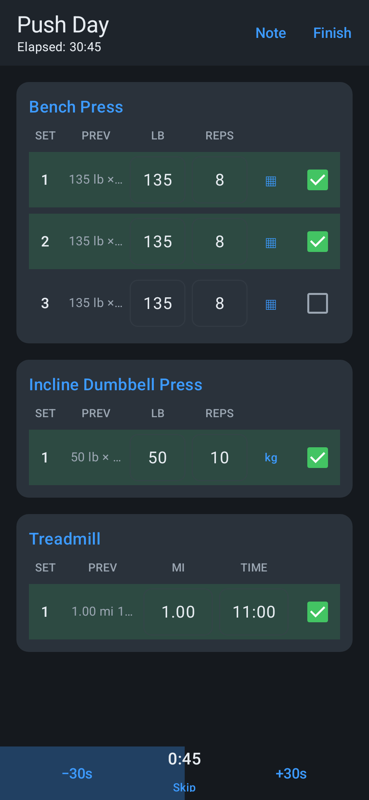

# ironlog



An offline lifting and PT tracker for Android. Log every set in pounds, get evidence-based
suggestions for when to add weight, and keep your data on your phone.

- **Pounds-native.** Weight is entered and stored in lb; the app converts to kg only where a
  machine's stack is labeled in kg.
- **Timed and cardio sets**, not just weight-and-reps: holds, distance, and pace all get their
  own columns.
- **Evidence-based progression suggestions**, each with a citation, shown as a prompt you accept
  or dismiss — nothing is changed automatically.
- **Non-destructive templates.** Changing how an exercise is logged, or swapping it out, never
  deletes anything you've already recorded.
- **Weekly JSON auto-backup**, so your history survives a lost or wiped phone.
- **Share a workout as a PDF** — the same set-by-set wording shown on screen, ready to send.
- **Import your history** from a CSV export of your previous tracker: save it as
  `app/src/main/assets/history_export.csv` before you build. A build without that file has no
  import button.

## Start here

This is an Android app source project, not an AI skill. Build it with the Android SDK and the requirements below, then install the debug APK on an Android device running Android 7.0 or newer. On Windows, run `gradlew.bat assembleDebug` from the repo root. Open the app and try a workout before supplying an import file. No AI account is needed to log workouts.

An agent can help with a build if it has the Android toolchain and file access. Ask: "Check the build requirements and explain how to build Ironlog for my device. Do not install an APK, import my history or modify an existing app's data without approval." Agent access is a development convenience, not an integration built into the app.

## Design rules

- Nothing leaves the phone. There is no account, no server, and no analytics.
- Suggestions are just that — the app never auto-changes a logged weight or rep count.

## Building

Requirements: JDK 17, Android Gradle Plugin 8.5.2, Kotlin 1.9.25.

Windows build command (this repo includes the Windows wrapper only):

```
gradlew.bat assembleDebug
```

The debug APK is written to `app/build/outputs/apk/debug/`.

## Help

For setup questions or errors, [open an issue](https://github.com/dtiger1889-ops/ironlog/issues) with the relevant versions and a redacted error description.

## License

MIT — see [LICENSE](LICENSE).
